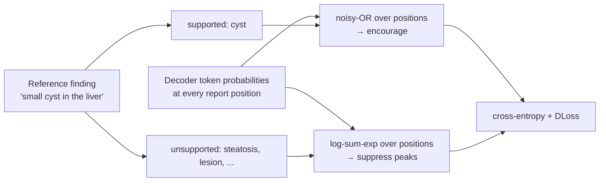

# Diagnostic Loss: Asymmetric Supervision for Radiology Report Generation

<!-- TODO before release: author list, affiliations, and the arXiv link/badge. -->

[](https://github.com/ikolton/diagnostic-loss/actions/workflows/tests.yml)
[](LICENSE)

Report-generation models trained with cross-entropy learn to write reports that
read like a radiologist's, but nothing in the objective asks them to state the
findings that are present and leave out the ones that are not. **Diagnostic Loss
(DLoss)** adds that pressure directly on the decoder's token probabilities:

- **supported** diagnoses (stated in the reference) should receive enough
  probability at *some* position of the report — pooled with noisy-OR;
- **unsupported** alternatives (other findings for the same organ) should stay
  unlikely at *every* position — pooled with a temperature log-sum-exp.

It is a training-only term added to cross-entropy: no extra heads, no changes to
the vision encoder or decoder, and no cost at inference.



## Installation

```bash
pip install diagnostic-loss
```

or from source, with the dependencies for the examples and tests:

```bash
git clone https://github.com/ikolton/diagnostic-loss.git
cd diagnostic-loss
pip install -e ".[examples,dev]"
```

The only runtime dependency is PyTorch ≥ 2.1. Install the PyTorch build for your
platform first if you need a specific CUDA version.

## Usage

```python
from diagnostic_loss import (
    DiagnosticLossConfig, DiagnosticVocabulary, EncodedTargetStore,
    causal_diagnostic_loss, encode_target_specs,
)

# Once, before training: targets for each organ finding, encoded for your tokenizer.
vocabulary = DiagnosticVocabulary.from_json("examples/example_vocabulary.json")
specs = [vocabulary.target_spec("study-17::liver", "liver", supported=["cyst"])]
rows, _ = encode_target_specs(specs, tokenizer)
store = EncodedTargetStore(rows)

# In the training step.
config = DiagnosticLossConfig(lambda_pos=0.001, lambda_neg=0.00025, tau=8.0)
outputs = model(**batch)  # labels are -100 outside the report
targets = store.for_batch(batch_sample_ids)
diagnostic = causal_diagnostic_loss(outputs.logits, batch["labels"], targets, config)
loss = outputs.loss + diagnostic.loss
```

Run the examples:

| Example | What it shows |
| --- | --- |
| [`quickstart.py`](examples/quickstart.py) | The full workflow on a toy decoder. Runs offline on CPU in seconds. |
| [`custom_layout.py`](examples/custom_layout.py) | Image placeholder tokens and an explicit report mask. |
| [`huggingface_qwen.py`](examples/huggingface_qwen.py) | A training step with Qwen2.5-0.5B and a trainable visual prefix. |
| [`build_targets.py`](examples/build_targets.py) | Labelled findings (JSONL) → target files for a tokenizer. |

```bash
python examples/quickstart.py
```

## Documentation

- [Method](docs/method.md): the equations, and where each term lives in the code.
- [Targets](docs/targets.md): the target format, tokenizer pitfalls, and how the
  paper's targets were built.
- [Integration](docs/integration.md): causal LMs, visual prefixes, custom layouts,
  DDP and gradient accumulation, and the coefficients used in the paper.

The per-backbone settings from the paper (decoder, LoRA, DLoss coefficients) are
in [`configs/paper/`](configs/paper).

## Results

Six 3D CT vision-language models, each fine-tuned with cross-entropy only and
with cross-entropy + DLoss under identical settings. Trained on Merlin and
CancerVerse (about 44k abdominal CT scans); evaluated on the Merlin test set
(in-distribution) and an external in-house set (out-of-distribution).

| Backbone | GREEN, Merlin | GREEN, external | RadGraph-F1, Merlin | RadGraph-F1, external |
| --- | --- | --- | --- | --- |
| Merlin | 53.82 → **54.65** | 45.01 → **46.25** | **35.01** → 35.00 | 26.36 → **26.71** |
| fVLM | 53.91 → **62.90** | 46.78 → **49.84** | 46.53 → **53.09** | 29.32 → **30.97** |
| BTB3D | 53.38 → **55.43** | 55.76 → **57.82** | 25.82 → **35.00** | 27.95 → **32.90** |
| HLIP | 56.15 → **60.24** | 49.54 → **53.97** | 48.02 → **50.20** | 34.22 → **37.60** |
| RadFM | 64.80 → **65.30** | 62.71 → **63.57** | 57.91 → **58.14** | 39.74 → **40.15** |
| SPECTRE | 45.35 → **53.19** | 41.34 → **55.37** | 41.95 → **46.74** | 26.53 → **33.56** |
| Mean change | +4.05 | +4.28 | +3.82 | +2.96 |

Across BLEU, ROUGE-L, METEOR, CIDEr, GREEN and RadGraph-F1, 71 of the 72
comparisons improve. The full table, a nine-seed analysis and ablations are in
the paper.

## Scope

This repository contains the loss, target encoding, and examples of using them
in a training step. It does not include the datasets, the report preprocessing
and semantic-tagging pipeline, the vocabulary used in the paper, or the
backbone-specific training code. The example vocabulary is illustrative only.

## Tests

```bash
pytest
```

The tests compare the batched implementation with a loop-based reference and
with a direct transcription of the equations, values and gradients, and cover
masking, mixed precision, target encoding, and the distributed scaling recipe.

## Citation

<!-- TODO before release: replace with the arXiv BibTeX entry. -->

```bibtex
@article{diagnosticloss2026,
  title  = {Diagnostic Loss: Asymmetric Supervision for Radiology Report Generation},
  author = {Kolton, Ignacy and others},
  year   = {2026}
}
```

## License

[MIT](LICENSE)
