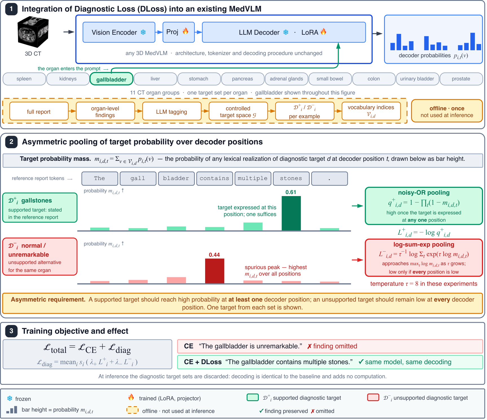

# Diagnostic Loss: Asymmetric Supervision for Radiology Report Generation

Ignacy Kolton<sup>1</sup>, Wenxuan Li<sup>2</sup>, Zongwei Zhou<sup>2</sup>,
Jarosław B. Ćwikła<sup>3</sup>, Arkadiusz Sitek<sup>4</sup>, Pedro R. A. S. Bassi<sup>2</sup>,
Szymon Płotka<sup>1</sup>

<sup>1</sup>Jagiellonian University, GMUM, Kraków ·
<sup>2</sup>Johns Hopkins University ·
<sup>3</sup>University of Warmia and Mazury, Olsztyn ·
<sup>4</sup>MGH & Harvard Medical School

<!-- TODO before release: arXiv link and badge. -->

[](LICENSE)

Diagnostic Loss (DLoss) is a training loss for radiology report generation,
computed from the decoder's token probabilities and added to cross-entropy.
For each organ finding, diagnoses stated in the reference report (supported)
should receive high probability at some position of the generated report, and
alternative diagnoses for the same organ (unsupported) should stay low at every
position. The two requirements are implemented with noisy-OR and log-sum-exp
pooling over positions. DLoss is used only during training.

The code follows the setup of the paper. Each report is split into findings per
organ, each finding is a separate training example with the organ named in the
prompt, and its supported and unsupported diagnoses come from labels prepared
in advance. The loss itself only needs token IDs and report positions for each
example, so targets built in a different way can be used with the same code.

<p align="center">
  
</p>

## Installation

```bash
git clone https://github.com/gmum/DLoss.git
cd DLoss
pip install -e .
```

The only runtime dependency is PyTorch ≥ 2.1; install the build for your
platform first if you need a specific CUDA version. To run the examples and
tests as well, use `pip install -e ".[examples,dev]"`.

To check the installation, run the first example:

```bash
python examples/quickstart.py
```

```
encoded 6 rows: 7 supported, 21 unsupported concepts
step  0  ce 3.527  supported +0.1782  unsupported -0.1436
step 20  ce 0.229  supported +0.0513  unsupported -0.3906
step 40  ce 0.145  supported +0.0496  unsupported -0.5173
step 60  ce 0.141  supported +0.0491  unsupported -0.5282
```

`supported` and `unsupported` are the two DLoss terms, already multiplied by
their coefficients. The unsupported term is a log-probability, so it is
negative; both terms decrease during training.

## Usage

```python
from diagnostic_loss import (
    DiagnosticLossConfig, DiagnosticVocabulary, EncodedTargetStore,
    causal_diagnostic_loss, encode_target_specs,
)

# Once, before training: targets for each organ finding, encoded for your tokenizer.
vocabulary = DiagnosticVocabulary.from_json("examples/example_vocabulary.json")
specs = [vocabulary.target_spec("study-17::liver", "liver", supported=["cyst"])]
rows, _ = encode_target_specs(specs, tokenizer)
store = EncodedTargetStore(rows)

# In the training step.
config = DiagnosticLossConfig(lambda_pos=0.001, lambda_neg=0.00025, tau=8.0)
sample_ids = batch.pop("sample_ids")  # returned by your dataset, one per example
outputs = model(**batch)  # labels are -100 outside the report
targets = store.for_batch(sample_ids)
diagnostic = causal_diagnostic_loss(outputs.logits, batch["labels"], targets, config)
loss = outputs.loss + diagnostic.loss
```

## Examples

| Script | Contents |
| --- | --- |
| [`quickstart.py`](examples/quickstart.py) | Target preparation and training of a small GRU decoder with cross-entropy and DLoss. |
| [`custom_layout.py`](examples/custom_layout.py) | DLoss with an explicit report mask for a sequence containing image tokens. |
| [`huggingface_qwen.py`](examples/huggingface_qwen.py) | One training step with Qwen2.5-0.5B and a visual prefix. |
| [`build_targets.py`](examples/build_targets.py) | Target files from a JSONL file of labelled findings. |

## Documentation

- [Method](docs/method.md): the equations, and where each term lives in the code.
- [Targets](docs/targets.md): the target format, tokenizer pitfalls, and how the
  paper's targets were built.
- [Integration](docs/integration.md): causal LMs, visual prefixes, custom layouts,
  DDP and gradient accumulation, and the coefficients used in the paper.

The per-backbone settings from the paper (decoder, LoRA, DLoss coefficients) are
in [`configs/paper/`](configs/paper).

## Results

Six 3D CT vision-language models, each fine-tuned with cross-entropy only and
with cross-entropy + DLoss under identical settings. Trained on Merlin and
CancerVerse (about 44k abdominal CT scans); evaluated on the Merlin test set
(in-distribution) and an external in-house set (out-of-distribution).

| Backbone | GREEN, Merlin | GREEN, external | RadGraph-F1, Merlin | RadGraph-F1, external |
| --- | --- | --- | --- | --- |
| Merlin | 53.82 → **54.65** | 45.01 → **46.25** | **35.01** → 35.00 | 26.36 → **26.71** |
| fVLM | 53.91 → **62.90** | 46.78 → **49.84** | 46.53 → **53.09** | 29.32 → **30.97** |
| BTB3D | 53.38 → **55.43** | 55.76 → **57.82** | 25.82 → **35.00** | 27.95 → **32.90** |
| HLIP | 56.15 → **60.24** | 49.54 → **53.97** | 48.02 → **50.20** | 34.22 → **37.60** |
| RadFM | 64.80 → **65.30** | 62.71 → **63.57** | 57.91 → **58.14** | 39.74 → **40.15** |
| SPECTRE | 45.35 → **53.19** | 41.34 → **55.37** | 41.95 → **46.74** | 26.53 → **33.56** |
| Mean change | +4.05 | +4.28 | +3.82 | +2.96 |

Across BLEU, ROUGE-L, METEOR, CIDEr, GREEN and RadGraph-F1, 71 of the 72
comparisons improve. The full table, a nine-seed analysis and ablations are in
the paper.

## Scope

This repository contains the loss, target encoding, and examples of using them
in a training step. It does not include the datasets, the report preprocessing
and semantic-tagging pipeline, the vocabulary used in the paper, or the
backbone-specific training code. The example vocabulary is illustrative only.

## Tests

```bash
pytest
```

The batched loss is tested against the loop-based reference and a direct
implementation of the equations, for both values and gradients.

## Citation

<!-- TODO before release: add journal/eprint fields from arXiv. -->

```bibtex
@article{kolton2026diagnosticloss,
  title  = {Diagnostic Loss: Asymmetric Supervision for Radiology Report Generation},
  author = {Kolton, Ignacy and Li, Wenxuan and Zhou, Zongwei and {\'C}wik{\l}a, Jaros{\l}aw B. and Sitek, Arkadiusz and Bassi, Pedro R. A. S. and P{\l}otka, Szymon},
  year   = {2026}
}
```

## Acknowledgments

We gratefully acknowledge Polish high-performance computing infrastructure
PLGrid (HPC Center: ACK Cyfronet AGH) for providing computer facilities and
support within computational grant no. PLG/2025/018792. This research was
funded in part by National Science Center, Poland 2025/57/B/ST6/03100.

## License

[MIT](LICENSE)
