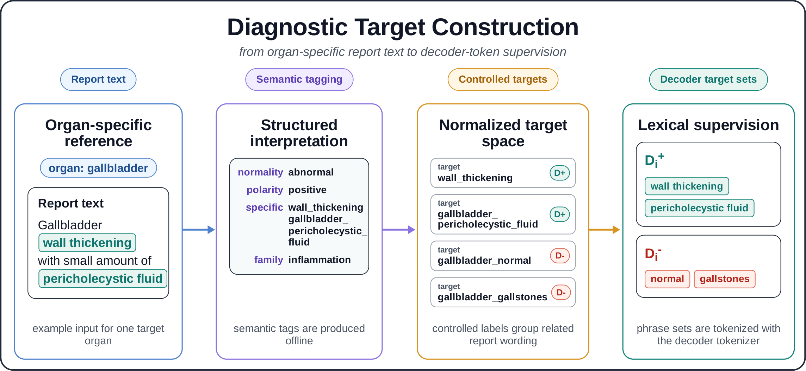

# Targets

[README](../README.md) · [Method](method.md) · [Integration](integration.md)

DLoss needs, for every training example, a list of supported concepts and a
list of unsupported alternatives, each given as lexical forms.

| Term | Meaning |
| --- | --- |
| finding | The text one training example covers; in the paper, the report text about one organ. |
| concept | A diagnosis, such as `cyst`, given by its lexical forms: the words and phrases that express it. |
| supported / unsupported | Concepts stated in the finding / other concepts for the same organ. |
| target row | The supported and unsupported concepts of one training example. |
| `sample_id` | Identifies a target row; your dataset returns it with each example. |
| `text_unit` | Free-text description of the row, such as `"liver finding"`; not used by the loss. |

In the paper every training example is a single organ finding. If your examples
are whole reports, one concept (for example `normal`) can be stated for one
organ and contradicted for another, which a single target row cannot express.

## From labelled findings: `DiagnosticVocabulary`

If your findings are already labelled with concepts (by an annotator, a
labeller such as CheXbert, or an LLM), describe the concepts once per organ:

```json
{
  "name": "my-vocabulary",
  "organs": {
    "liver": {
      "normal": ["normal"],
      "steatosis": ["fatty", "steatosis"],
      "cyst": ["cyst", "cysts"]
    }
  }
}
```

and build a row per finding:

```python
from diagnostic_loss import DiagnosticVocabulary

vocabulary = DiagnosticVocabulary.from_json("vocabulary.json")
spec = vocabulary.target_spec("study-17::liver", "liver", supported=["cyst"])
# supported: cyst; unsupported: normal, steatosis
```

By default every other concept of the organ is unsupported; pass
`unsupported=[...]` to choose them yourself. Each phrase is also added with a
leading space (`add_leading_space=True`), because most subword tokenizers
encode `"cyst"` and `" cyst"` differently.

[`examples/build_targets.py`](../examples/build_targets.py) does this for a JSONL
file of labelled findings and writes both target files described below:

```bash
python examples/build_targets.py \
    --findings examples/example_findings.jsonl \
    --vocabulary examples/example_vocabulary.json \
    --tokenizer Qwen/Qwen2.5-0.5B \
    --out-dir targets/
```

> [!NOTE]
> [`examples/example_vocabulary.json`](../examples/example_vocabulary.json) is a
> small example vocabulary used by the examples and tests.

## Target file format

Lexical targets are stored as JSONL, one row per finding:

```json
{"schema_version": "diagnostic-loss-spec-v1", "sample_id": "study-17::liver", "text_unit": "liver finding", "positive_concepts": [{"name": "cyst", "phrases": ["cyst", " cyst"]}], "negative_concepts": [{"name": "steatosis", "phrases": ["fatty", " fatty"]}]}
```

- `sample_id` must be unique; your data loader returns it with each example.
- `sample_weight` and each concept's `weight` are optional (default 1.0).
- A row with both lists empty is valid and contributes nothing to the loss. A
  sample ID with no row raises an error.

Rows can also be built directly in Python with `TargetSpec` and
`LexicalConcept`, and written with `save_target_specs`.

## Encoding for a tokenizer

```python
from diagnostic_loss import encode_target_specs, load_target_specs, save_encoded_targets

specs = load_target_specs("targets/targets.jsonl")
rows, audit = encode_target_specs(specs, tokenizer)
save_encoded_targets("targets/encoded_targets.jsonl", rows, audit)
```

The tokenizer needs `encode(text, add_special_tokens=False)` and `get_vocab()`;
Hugging Face tokenizers provide both.

Each concept becomes the set of token IDs of all its phrases. Encoding fails if
a phrase produces a special token or an ID outside the vocabulary, or if a token
ID appears on both the supported and the unsupported side of a row (for example
`"liver mass"` vs `"liver cyst"` would share `liver`). Pass `allow_overlap=True`
to keep such rows; `audit.overlap_token_ids` reports how many IDs are shared.

The encoded file stores a SHA-256 fingerprint of the tokenizer vocabulary.
`EncodedTargetStore.from_jsonl(path, tokenizer)` refuses to load it with a
different vocabulary.

### Check your lexical forms

Look at how your tokenizer splits each phrase before training. With Qwen2.5,
for example, `" cyst"` is one token but `"cyst"` is `c` + `yst`, and
`"hydronephrosis"` contains the piece `one`. If a concept's pieces are common
subwords, the loss also changes the probability of unrelated words that share
them. Prefer forms that split into few, specific pieces, and leave organ names
out of the phrases.

## How the paper's targets were built

The targets in the paper were produced in three steps (Appendix,
"Report preprocessing" and "Diagnostic supervision construction"):



1. **Organ findings.** Qwen3 split each free-text report into one finding per
   organ.
2. **Semantic tags.** Each finding was tagged with structured diagnostic labels
   from a controlled, organ-specific set.
3. **Lexical targets.** The tags were mapped to diagnostic concepts and their
   lexical forms. Supported concepts are the ones stated in the finding;
   unsupported ones are alternative findings for the same organ.

`DiagnosticVocabulary` implements step 3 for labels you already have.
